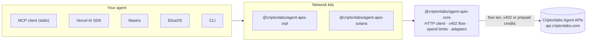
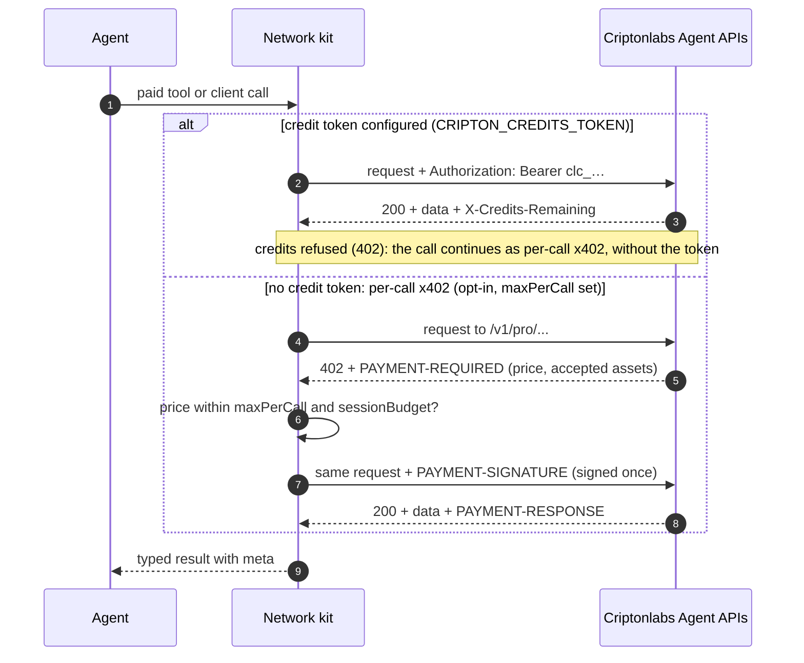
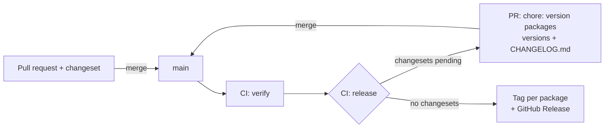

<p align="center">
  
</p>

<h1 align="center">Criptonlabs Agent APIs SDK</h1>

<p align="center">
  TypeScript SDK for AI agents to use the hosted Criptonlabs Agent APIs (<a href="https://api.criptonlabs.com">https://api.criptonlabs.com</a>): read-only, agent-friendly data endpoints with optional pay-per-call access.
</p>

<p align="center">
  <a href="https://github.com/criptonlabs/agent-apis-sdk/actions/workflows/ci.yml"></a>
  <a href="LICENSE"></a>
  <a href="https://nodejs.org"></a>
  <a href="https://pnpm.io"></a>
  <a href="https://www.typescriptlang.org"></a>
  <a href="https://www.conventionalcommits.org"></a>
  <a href="https://github.com/changesets/changesets"></a>
  <a href="https://github.com/gitleaks/gitleaks"></a>
  <a href="https://github.com/criptonlabs/agent-apis-sdk/commits/main"></a>
</p>

<p align="center">
  <a href="https://modelcontextprotocol.io"></a>
  <a href="https://www.x402.org"></a>
  <a href="https://ai-sdk.dev"></a>
  <a href="https://mastra.ai"></a>
  <a href="https://github.com/elizaOS/eliza"></a>
  <a href="https://xrpl.org"></a>
  <a href="https://solana.com"></a>
</p>

<p align="center">
  <a href="#quick-start">Quick start</a> ·
  <a href="#architecture">Architecture</a> ·
  <a href="#packages">Packages</a> ·
  <a href="#how-payment-works">Payments</a> ·
  <a href="#security">Security</a> ·
  <a href="CONTRIBUTING.md">Contributing</a>
</p>

## Status

> [!IMPORTANT]
> **Pre-release.** Nothing is published to npm yet; use the packages from this repository. Versions and release notes live in each package's `CHANGELOG.md` and in the repository's [GitHub Releases](https://github.com/criptonlabs/agent-apis-sdk/releases). Interfaces may change before the first npm publication.

## What it is, and is not

- It is a typed client of the hosted Criptonlabs Agent APIs. It validates responses, maps API errors to typed errors, and exposes the same tools through MCP, the Vercel AI SDK, Mastra, ElizaOS and a CLI.
- It is not the API. It does not re-implement API logic, run a node, or store prices: prices are read from the API at runtime.
- It never signs or submits your own transfers: payment preparation returns an unsigned transaction. It signs only what you opt into: x402 payments to the API, credit top-ups and, on Solana, Sign-In-With-X proofs.

## Architecture



Network kits hold only network-specific code (routes, payment scheme, assets, tools); everything common lives in the core.

## Packages

| Package                          | Version                                                                                                                                                                                                                 | Purpose                                                                     | Entry points                                                             |
| -------------------------------- | ----------------------------------------------------------------------------------------------------------------------------------------------------------------------------------------------------------------------- | --------------------------------------------------------------------------- | ------------------------------------------------------------------------ |
| `@criptonlabs/agent-apis-core`   | [](https://github.com/criptonlabs/agent-apis-sdk/releases)     | Network-independent core for kit authors: HTTP client, x402 flow, adapters  | `.`, `./mcp`, `./ai-sdk`, `./mastra`, `./eliza`, `./cli`                 |
| `@criptonlabs/agent-apis-xrpl`   | [](https://github.com/criptonlabs/agent-apis-sdk/releases)     | XRP Ledger kit: 15 tools, payment preparation, DEX quote, CLI               | `.`, `./mcp`, `./ai-sdk`, `./mastra`, `./eliza`; bin `agent-apis-xrpl`   |
| `@criptonlabs/agent-apis-solana` | [](https://github.com/criptonlabs/agent-apis-sdk/releases) | Solana kit: 7 tools plus an opt-in purchase tool, transfer preparation, CLI | `.`, `./mcp`, `./ai-sdk`, `./mastra`, `./eliza`; bin `agent-apis-solana` |

End users want a network kit (`@criptonlabs/agent-apis-xrpl` or `@criptonlabs/agent-apis-solana`); the core is for people who build kits.

## Features

- Typed data clients for the `/v1/xrpl/*` and `/v1/solana/*` routes, with the `meta` freshness block on every response.
- Agent tools from one definition list per kit, served over MCP (stdio), Vercel AI SDK, Mastra, ElizaOS and CLI.
- Opt-in pay-per-call with x402, with mandatory per-call and optional session spend limits.
- Prepaid credits: spend with a credit token (or, on Solana, a Sign-In-With-X wallet signature) and buy them with an explicit, capped top-up.
- Unsigned payment preparation (readiness check, path, fee) and DEX quotes with a slippage limit.
- RFC 9457 problems from the API surfaced as typed errors.
- `SKILL.md` and `.cursorrules` guidance files for coding agents.

## Requirements

- Node.js >= 22.18.
- pnpm 11 for development (pinned by `packageManager`).

## Quick start

Pre-release: clone the repository and run `pnpm install`, then:

```ts
import { createXrplAgentKit } from "@criptonlabs/agent-apis-xrpl";
import { createSolanaAgentKit } from "@criptonlabs/agent-apis-solana";

const xrpl = createXrplAgentKit(); // free tier, hosted API
const fee = await xrpl.data.fee();
console.log(fee.data, fee.data.meta);

const solana = createSolanaAgentKit();
const slot = await solana.data.latestSlot();
console.log(slot.data.slot, slot.data.meta);
```

## How payment works

- The free tier (`/v1/xrpl/*`, `/v1/solana/*`) needs no configuration or payment.
- The paid tier (`/v1/pro/xrpl/*`, `/v1/pro/solana/*`) is charged with x402 only when you opt in: RLUSD on the XRP Ledger, or USDC / EURC on Solana. Routes the API sells only for prepaid credits raise `credits-required` unless the kit holds credits (see [Prepaid credits](#prepaid-credits)).
- Per-call opt-in requires `CRIPTON_TIER=pro`, the kit's payer key (`CRIPTON_XRPL_PAYER_SEED` or `CRIPTON_SOLANA_PAYER_KEY`) and `CRIPTON_MAX_PER_CALL`. `maxPerCall` is mandatory: without it the client never pays per call.
- `CRIPTON_SESSION_BUDGET` is an optional cap on the total spent in a session.
- Prices come from the API at runtime (`GET /v1/pro/requirements`, `kit.prices()`, `kit.priceOf`); the SDK stores none.



See [packages/xrpl/README.md](packages/xrpl/README.md) and [packages/solana/README.md](packages/solana/README.md) for details.

## Prepaid credits

- With `CRIPTON_TIER=pro` and a credit token in `CRIPTON_CREDITS_TOKEN` (in code, `credits: { token }` with the value read from the environment), paid-tier calls carry `Authorization: Bearer` and spend credits instead of paying per call. The token needs tier `pro` and is a secret: keep it in the environment or a secret store, never written in code, prompts, logs or command-line arguments. If the API refuses the credits (402), the call continues as one without credentials: it pays per call with x402 when a payer and `maxPerCall` are configured (the paid retry never resends the token), and otherwise raises `CriptonPaymentError`.
- `kit.credits.lastKnownBalance()` returns the balance per denomination from the API's last credit-paid answer (`null` before one; there is no balance request). The status tools `xrpl_credits_status` and `solana_credits_status` and the CLI `credits` command report it, with whether a token is configured and the process's top-up spend, never the token.
- Credits are bought only through an explicit top-up (`kit.credits.topup({ bundle, maxAmount })`, the CLI `topup <bundle> --max <amount>` or, on Solana only, the opt-in MCP tool `solana_credits_topup`; see [Purchase limits](#purchase-limits)), paid with the kit wallet: RLUSD on the XRP Ledger, USDC or EURC on Solana. Bundle ids and prices come from the API at runtime. The kit never buys credits on its own.

## Sign-In-With-X (Solana only)

- With `CRIPTON_SOLANA_SIWX=on` (or `credits: { siwx: true }` in code), tier `pro` and `CRIPTON_SOLANA_PAYER_KEY`, the Solana kit answers the API's Sign-In-With-X challenges with a signature of the payer wallet and spends that wallet's credits without a token. A configured credit token always comes first.
- `agent-apis-solana rotate-token` (`kit.credits.rotateToken()`) issues a new credit token for the wallet with a Sign-In-With-X proof; the API revokes the wallet's earlier tokens. Rotation never debits credits.
- Sign-In-With-X spending and rotation need the optional peer `@x402/extensions`.
- The XRPL kit has no Sign-In-With-X and no token rotation.

## Purchase limits

> [!WARNING]
> **Purchases have their own limits; the per-call limits never apply to them.**

- A top-up needs its own maximum: `maxAmount` in `kit.credits.topup({ bundle, maxAmount })`, `--max` in the CLI `topup <bundle> --max <amount>`. A bundle priced above it is refused before anything is signed.
- `maxPerCall` and `sessionBudget` never apply to purchases; they limit per-call payments only. `credits.topupBudget` caps the total of the process's purchases, and a purchase whose answer is lost counts as spent.
- A credit token is shown once: `kit.credits.topup` (and, on Solana, `kit.credits.rotateToken`) return it, serialized results show `[redacted]`, and the CLI `topup` (and `rotate-token`) print it once. Store it in `CRIPTON_CREDITS_TOKEN` right away.
- Solana: the MCP tool `solana_credits_topup` exists only with tier `pro`, `CRIPTON_SOLANA_PAYER_KEY`, `CRIPTON_TOPUP_MAX` (its per-purchase maximum) and `CRIPTON_TOPUP_BUDGET` (its per-process budget). It never shows the token to the model and reports `tokenKept`; when `tokenKept` is false the purchase still happened, and `rotate-token` recovers a token for the wallet's credits.
- XRPL: the kit has no purchase tool and ignores `CRIPTON_TOPUP_MAX` and `CRIPTON_TOPUP_BUDGET`; its purchase limits are `--max` in the CLI, and `maxAmount` with `credits.topupBudget` in code. An XRPL wallet cannot recover a lost credit token.

Details: [Prepaid credits](packages/xrpl/README.md#prepaid-credits) and [Purchase limits](packages/xrpl/README.md#purchase-limits) of the XRPL kit, [Prepaid credits](packages/solana/README.md#prepaid-credits) and [Purchase limits](packages/solana/README.md#purchase-limits) of the Solana kit.

## Security

- Seeds, keys and credit tokens are read only from the environment. The CLI rejects `--seed`, `--secret`, `--private-key`, `--key`, `--payer-key`, `--token`, `--credits-token` and any argument containing `clc_`.
- No tool result or tool error contains a credit token.
- gitleaks runs as a fail-closed pre-commit hook (with lint and typecheck; tests, build and exports run in pre-push) and in CI, with extra rules for XRPL seeds, Solana keys and `clc_` tokens.
- Prepared payments are unsigned; review them before signing elsewhere.

Report vulnerabilities as described in [SECURITY.md](SECURITY.md).

## Repository layout

<details>
<summary>Show the repository layout</summary>

| Path              | Content                                                    |
| ----------------- | ---------------------------------------------------------- |
| `packages/core`   | `@criptonlabs/agent-apis-core`                             |
| `packages/xrpl`   | `@criptonlabs/agent-apis-xrpl`                             |
| `packages/solana` | `@criptonlabs/agent-apis-solana`                           |
| `tests/exports`   | Built-entry import check for every package                 |
| `tests/fixtures`  | OpenAPI snapshot shared by the kits' contract tests        |
| `scripts/`        | Secret-rule verification, local e2e API stack              |
| `.github/`        | CI workflow, issue forms, pull request template            |
| `.changeset/`     | Pending changesets (release notes for the next version PR) |

</details>

## Development

```bash
pnpm install
pnpm typecheck
pnpm lint
pnpm test
pnpm build
pnpm test:exports
```

See [CONTRIBUTING.md](CONTRIBUTING.md) for the workflow and rules.

## Versioning and releases

- Versions are independent per package, managed with changesets. Nobody edits versions by hand.
- On pushes to `main`, CI opens or updates a "chore: version packages" pull request that bumps versions and writes each package's `CHANGELOG.md`.
- Merging that PR makes CI create one git tag per package (`<package name>@<version>`) and one GitHub Release per tag.
- Nothing is published to npm yet; the packages keep `"private": true` until then.



See [CONTRIBUTING.md](CONTRIBUTING.md#changesets-and-releases) for the flow.

## Documentation

- [CONTRIBUTING.md](CONTRIBUTING.md)
- [SECURITY.md](SECURITY.md)
- [packages/core/README.md](packages/core/README.md)
- [packages/xrpl/README.md](packages/xrpl/README.md)
- [packages/solana/README.md](packages/solana/README.md)

## License

Apache License 2.0, see [LICENSE](LICENSE) and [NOTICE](NOTICE). Names and marks are covered by the [trademark policy](https://github.com/criptonlabs/agent-apis-sdk/blob/main/TRADEMARKS.md).

## Disclaimer

This kit is free, open-source software released under the Apache License 2.0. It is not a product or service for sale: nobody is charged for downloading, installing or using it, and nobody is required to use it.

- The only charges that exist are made by the hosted Criptonlabs Agent APIs for their paid calls, and only when you configure payment yourself. Any payment is between you and the API, under the conditions the API publishes; this kit only signs the payments you authorize, within the limits you set.
- The software is experimental and provided "as is", without warranty of any kind, as stated in the `LICENSE`. API data and tool output may be inaccurate, incomplete, delayed or unavailable.
- Nothing in this kit or its output is financial, investment, legal, tax or accounting advice, or an offer or solicitation to buy or sell any asset.
- You are solely responsible for how you or your agents use the kit, for your keys and seeds, for every transaction you sign or submit, and for checking that its output fits your use case. You assume all risks, including the loss of funds.
- To the maximum extent permitted by applicable law, the authors and copyright holders are not liable for any loss or damage arising from the use, misuse, modification or inability to use this software, including defects or bugs, or from any modified copy or fork.
