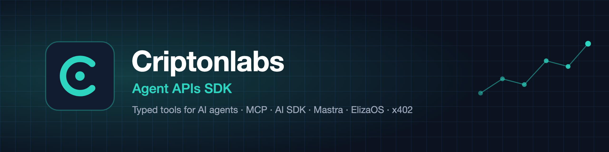

<p align="center">
  
</p>

# Criptonlabs Agent APIs SDK

TypeScript SDK for AI agents to use the hosted Criptonlabs Agent APIs (https://api.criptonlabs.com): read-only, agent-friendly data endpoints with optional pay-per-call access.

## Status

Pre-release. The repository is private and nothing is published to npm yet; packages are at version `0.0.0`. Interfaces may change before the first release.

## What it is, and is not

- It is a typed client of the hosted Criptonlabs Agent APIs. It validates responses, maps API errors to typed errors, and exposes the same tools through MCP, the Vercel AI SDK, Mastra, ElizaOS and a CLI.
- It is not the API. It does not re-implement API logic, run a node, or store prices: prices are read from the API at runtime.
- It never signs or submits your own transfers. Payment preparation returns an unsigned transaction.

## Packages

| Package                          | Purpose                                                                    | Entry points                                                             |
| -------------------------------- | -------------------------------------------------------------------------- | ------------------------------------------------------------------------ |
| `@criptonlabs/agent-apis-core`   | Network-independent core for kit authors: HTTP client, x402 flow, adapters | `.`, `./mcp`, `./ai-sdk`, `./mastra`, `./eliza`, `./cli`                 |
| `@criptonlabs/agent-apis-xrpl`   | XRP Ledger kit: 14 tools, payment preparation, DEX quote, CLI              | `.`, `./mcp`, `./ai-sdk`, `./mastra`, `./eliza`; bin `agent-apis-xrpl`   |
| `@criptonlabs/agent-apis-solana` | Solana kit: 6 tools, transfer preparation, CLI                             | `.`, `./mcp`, `./ai-sdk`, `./mastra`, `./eliza`; bin `agent-apis-solana` |

End users want a network kit (`@criptonlabs/agent-apis-xrpl` or `@criptonlabs/agent-apis-solana`); the core is for people who build kits.

## Features

- Typed data clients for the `/v1/xrpl/*` and `/v1/solana/*` routes, with the `meta` freshness block on every response.
- 14 agent tools from one definition list, served over MCP (stdio), Vercel AI SDK, Mastra, ElizaOS and CLI.
- Opt-in pay-per-call with x402, with mandatory per-call and optional session spend limits.
- Unsigned payment preparation (readiness check, path, fee) and DEX quotes with a slippage limit.
- RFC 9457 problems from the API surfaced as typed errors.
- `SKILL.md` and `.cursorrules` guidance files for coding agents.

## Requirements

- Node.js >= 22.18.
- pnpm 11 for development (pinned by `packageManager`).

## Quick start

Pre-release: clone the repository and run `pnpm install`, then:

```ts
import { createXrplAgentKit } from "@criptonlabs/agent-apis-xrpl";
import { createSolanaAgentKit } from "@criptonlabs/agent-apis-solana";

const xrpl = createXrplAgentKit(); // free tier, hosted API
const fee = await xrpl.data.fee();
console.log(fee.data, fee.data.meta);

const solana = createSolanaAgentKit();
const slot = await solana.data.latestSlot();
console.log(slot.data.slot, slot.data.meta);
```

## How payment works

- The free tier (`/v1/xrpl/*`, `/v1/solana/*`) needs no configuration or payment.
- The paid tier (`/v1/pro/xrpl/*`, `/v1/pro/solana/*`) is charged with x402 only when you opt in: RLUSD on the XRP Ledger, or USDC / EURC on Solana. Routes the API sells only for prepaid credits raise `credits-required`.
- Opt-in requires `CRIPTON_TIER=pro`, the kit's payer key (`CRIPTON_XRPL_PAYER_SEED` or `CRIPTON_SOLANA_PAYER_KEY`) and `CRIPTON_MAX_PER_CALL`. `maxPerCall` is mandatory: without it the client never pays.
- `CRIPTON_SESSION_BUDGET` is an optional cap on the total spent in a session.
- Prices come from the API at runtime (`GET /v1/pro/requirements`, `kit.priceOf`); the SDK stores none.

See [packages/xrpl/README.md](packages/xrpl/README.md) and [packages/solana/README.md](packages/solana/README.md) for details.

## Security

- Seeds are read only from the environment. The CLI rejects `--seed`, `--secret` and `--private-key`.
- gitleaks runs as a fail-closed pre-commit hook (with lint and typecheck; tests, build and exports run in pre-push) and in CI, with extra rules for XRPL seeds, Solana keys and `clc_` tokens.
- Prepared payments are unsigned; review them before signing elsewhere.

Report vulnerabilities as described in [SECURITY.md](SECURITY.md).

## Repository layout

| Path              | Content                                             |
| ----------------- | --------------------------------------------------- |
| `packages/core`   | `@criptonlabs/agent-apis-core`                      |
| `packages/xrpl`   | `@criptonlabs/agent-apis-xrpl`                      |
| `packages/solana` | `@criptonlabs/agent-apis-solana`                    |
| `tests/exports`   | Built-entry import check for every package          |
| `tests/fixtures`  | OpenAPI snapshot shared by the kits' contract tests |
| `scripts/`        | Repository tooling (secret-rule verification)       |
| `.github/`        | CI workflow, issue forms, pull request template     |
| `.changeset/`     | Pending version changes                             |

## Development

```bash
pnpm install
pnpm typecheck
pnpm lint
pnpm test
pnpm build
pnpm test:exports
```

See [CONTRIBUTING.md](CONTRIBUTING.md) for the workflow and rules.

## Documentation

- [CONTRIBUTING.md](CONTRIBUTING.md)
- [SECURITY.md](SECURITY.md)
- [packages/core/README.md](packages/core/README.md)
- [packages/xrpl/README.md](packages/xrpl/README.md)
- [packages/solana/README.md](packages/solana/README.md)

## License

Apache License 2.0, see [LICENSE](LICENSE) and [NOTICE](NOTICE). Names and marks are covered by the [trademark policy](https://github.com/criptonlabs/agent-apis-sdk/blob/main/TRADEMARKS.md).

## Disclaimer

This kit is free, open-source software released under the Apache License 2.0. It is not a product or service for sale: nobody is charged for downloading, installing or using it, and nobody is required to use it.

- The only charges that exist are made by the hosted Criptonlabs Agent APIs for their paid calls, and only when you configure payment yourself. Any payment is between you and the API, under the conditions the API publishes; this kit only signs the payments you authorize, within the limits you set.
- The software is experimental and provided "as is", without warranty of any kind, as stated in the `LICENSE`. API data and tool output may be inaccurate, incomplete, delayed or unavailable.
- Nothing in this kit or its output is financial, investment, legal, tax or accounting advice, or an offer or solicitation to buy or sell any asset.
- You are solely responsible for how you or your agents use the kit, for your keys and seeds, for every transaction you sign or submit, and for checking that its output fits your use case. You assume all risks, including the loss of funds.
- To the maximum extent permitted by applicable law, the authors and copyright holders are not liable for any loss or damage arising from the use, misuse, modification or inability to use this software, including defects or bugs, or from any modified copy or fork.
